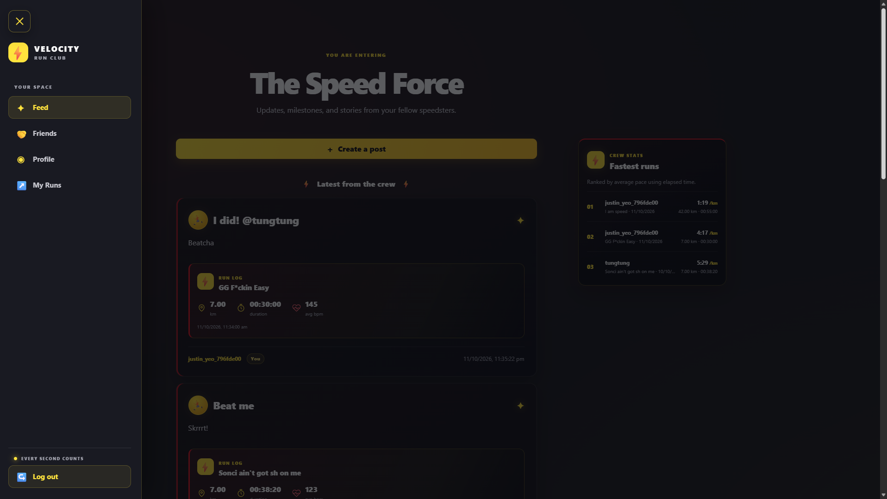

# Velocity Run Club

Velocity Run Club is a community space for runners to share updates, record runs, keep up with friends, and review their running progress.

## Getting started

Open the Velocity Run Club website and either:

- Choose **Continue with Google** to sign in with your Google account, or
- Choose **Sign up** to create an account with a username, email address, and password.

If you already have an account, choose **Log in**. Once signed in, use the sidebar to move between the Feed, Friends, Profile, and My Runs. Choose **Log out** at the bottom of the sidebar when you are finished.

## Using the site

### Feed

The Feed is where you can catch up with the club and share your own updates. Select **Create a post** to open the post form. Add a title and message, then choose who can see it:

- **Public**: visible to everyone who can access the feed.
- **Friends only**: shared with your friends on the site.

You can also attach an image or include a run with distance, date, duration, and optional training details. Posts appear newest first. The feed’s **Fastest runs** board ranks runs by average pace, calculated from distance and elapsed time.

### My Runs

My Runs shows your run history, with the latest run first. Run entries can include distance, duration, moving time, elevation gain, and heart-rate information when those details are available. If you have not recorded a run yet, you will see the page’s introductory message.

### Friends

Friends shows your connections on the site. If you do not have any friends yet, the page displays **“You will never run alone.”**

### Profile

Your Profile brings together your account information and running summary, such as your activity and recent posts when available.

## Run details

- **Distance** is the length of the run in kilometres.
- **Duration** is the total elapsed time from start to finish.
- **Moving time** is time spent moving; it can be shorter than duration when you paused or stopped.
- **Elevation gain** is the total uphill height gained, in metres.
- **Average and maximum heart rate** are measured in beats per minute (bpm).

Optional run details can be left blank if you do not have them.

## Tech stack

- React & React Router
- Vite
- Bootstrap
- Supabase Database/Auth/Storage
- Railway
- Jest
- React Testing Library
